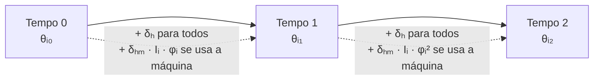
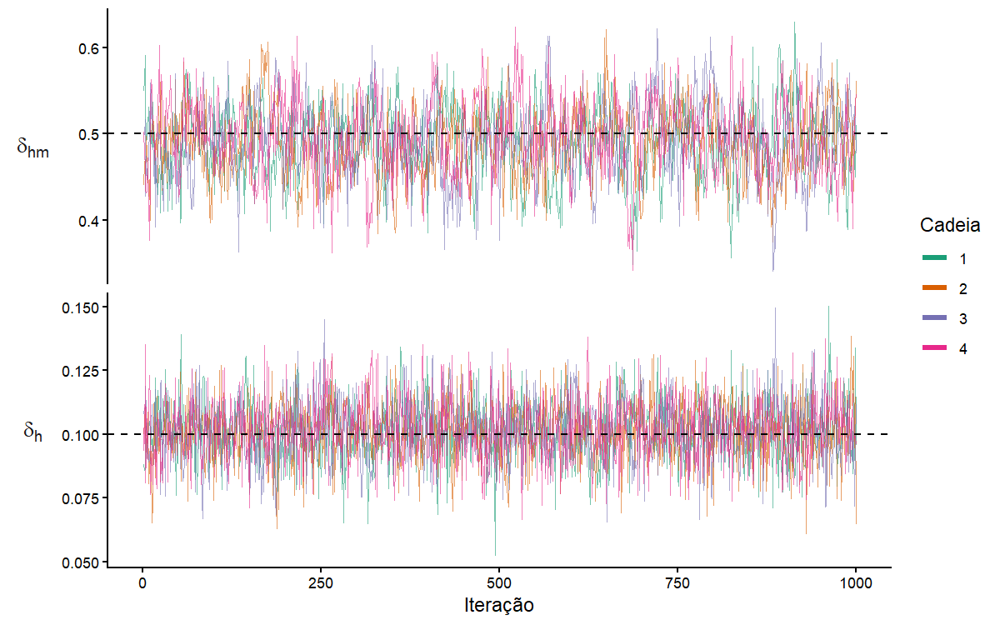
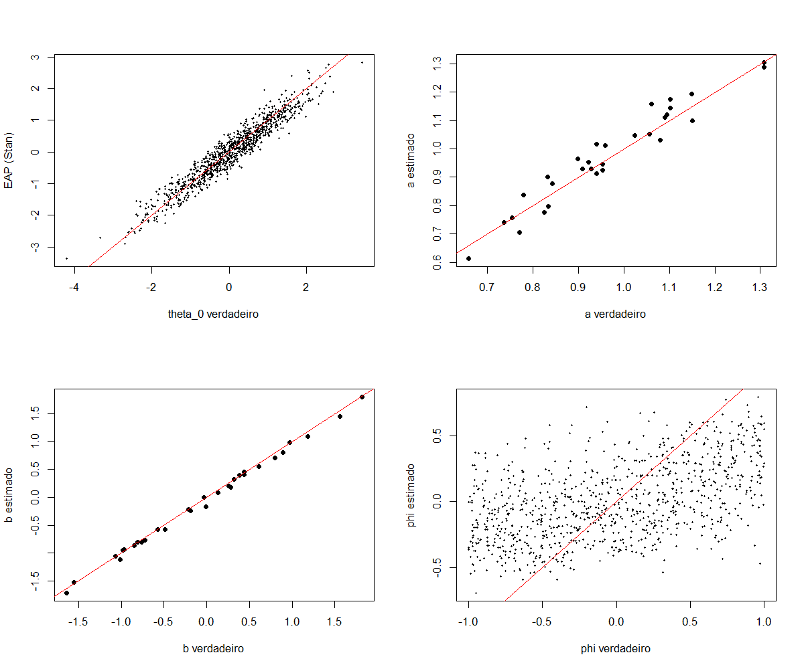

# Simulação em TRI: efeito humano-máquina

Estudo de simulação da Iniciação Científica em Teoria de Resposta ao Item (TRI), orientada pelo Prof. Gabriel Assunção.

A pergunta é simples: se as mesmas pessoas respondem ao **mesmo teste em três momentos**, dá para recuperar o efeito do uso de uma máquina sobre a habilidade delas?

Este repositório tem duas camadas:

1. **O estudo.** Gerar respostas, estimar parâmetros e ver o que se recupera.
2. **A otimização do Stan** (branch `otimizacao-stan`). O modelo estatístico ficou igual; o código passou a calcular o mesmo posterior bem mais rápido, para dar para testar testes maiores.

---

## Sumário

- [A ideia do estudo](#a-ideia-do-estudo)
- [O modelo](#o-modelo)
- [Como reproduzir](#como-reproduzir)
- [O que otimizamos no Stan](#o-que-otimizamos-no-stan)
- [Resultados da velocidade](#resultados-da-velocidade)
- [Resultados da recuperação (seed = 15)](#resultados-da-recuperação-uma-réplica-seed--15)
- [Arquivos](#arquivos)
- [Autor](#autor)

---

## A ideia do estudo

Imagine 1.000 pessoas fazendo um teste de 30 itens, três vezes (`t = 0, 1, 2`). Quase todas (90%) usam uma máquina entre uma aplicação e outra. A máquina pode ajudar ou atrapalhar, e o tamanho desse efeito **muda de pessoa para pessoa**. Além disso, todo mundo muda um pouco com o tempo, mesmo sem máquina.

Na simulação, nós **conhecemos** os valores verdadeiros (habilidade, itens, efeitos). Depois fingimos que não conhecemos e tentamos recuperá-los só pelas respostas 0/1.

Há dois estimadores:

| Método | O que usa | O que estima |
|---|---|---|
| **mirt** (2PL clássico) | só o tempo 0 | habilidade inicial (`θ₀`) e parâmetros dos itens (`a`, `b`) |
| **Stan** (bayesiano) | os três tempos de uma vez | tudo isso **e** os efeitos `δ_hm`, `δ_h` e `φ_i` |

O mirt serve de referência e também de **chute inicial** para o Stan. O Stan é o modelo do estudo, porque os efeitos da máquina só aparecem quando se olha a mudança no tempo.

Três tamanhos de teste (escolha em [`R/config.R`](R/config.R)):

| Cenário | Pessoas | Itens | Para quê |
|---|---:|---:|---|
| `base` | 1.000 | 30 | reproduz o README (`seed = 15`) |
| `medio` | 2.000 | 50 | pedido para ver se escala |
| `grande` | 4.000 | 80 | o original ficava pesado demais |

---

## O modelo

Cada pessoa *i* responde aos mesmos *J* itens nos tempos *t* = 0, 1, 2, com o modelo logístico de dois parâmetros (2PL):

```math
P(X_{ijt} = 1) = \mathrm{logit}^{-1}\big(a_j\,(\theta_{it} - b_j)\big)
```

Em português: a chance de acertar sobe se a pessoa é mais hábil (`θ` alto) ou se o item é mais fácil (`b` baixo). O `a` diz o quanto o item separa quem sabe de quem não sabe.

De um tempo para o outro, a habilidade muda assim:

```math
\begin{aligned}
\theta_{i1} &= \theta_{i0} + \delta_{hm}\, I_i\, \phi_i + \delta_h \\
\theta_{i2} &= \theta_{i1} + \delta_{hm}\, I_i\, \phi_i^2 + \delta_h
\end{aligned}
```



Leitura rápida:

- `I_i = 1` se a pessoa usa a máquina; senão o termo da máquina some.
- `δ_h` é o efeito humano, **igual para todo mundo**.
- `δ_hm` é o tamanho global do efeito da máquina (sempre positivo no modelo).
- `φ_i` diz **para aquela pessoa** se a máquina ajuda (`φ > 0`) ou atrapalha (`φ < 0`). No segundo salto entra `φ²`, então o sinal desse segundo pedaço da máquina é sempre o de `δ_hm`.

Valores usados para **gerar** os dados e priors usadas no **Stan** ([`stan/modelo_tri.stan`](stan/modelo_tri.stan)). As distribuições seguem a parametrização do R e do Stan: N(média, desvio-padrão) e lognormal(meanlog, sdlog).

| Símbolo | Significado | Valor na simulação | Prior no Stan |
|---|---|---|---|
| `θ_{i0}` | habilidade inicial | N(0, 1) | N(0, 1) |
| `I_i` | 1 se usa a máquina | Bernoulli(0,9) | observado (não se estima) |
| `φ_i` | quanto a pessoa se beneficia (ou se prejudica) | U(−1, 1) | U(−1, 1) |
| `δ_hm` | efeito humano-máquina | 0,5 | half-normal(0, 1) |
| `δ_h` | efeito humano, comum a todos | 0,1 | N(0, 1) |
| `a_j` | discriminação do item | lognormal(0; 0,18) | lognormal(0; 0,5) |
| `b_j` | dificuldade do item | N(0, 1) | N(0, 5) |

---

## Como reproduzir

Pastas: funções e parâmetros em `R/`, modelo em `stan/`, execução em `scripts/`, resultados em `output/`.

Requisitos: R 4.5 e CmdStan 2.40 (no Windows, também o [Rtools](https://cran.r-project.org/bin/windows/Rtools/) para compilar o modelo). Ao abrir `ic-tri-simulacao.Rproj` no RStudio, o [renv](https://rstudio.github.io/renv/) ativa sozinho e usa as versões do `renv.lock`. No Windows, o `.Rprofile` guarda essa biblioteca em `%LOCALAPPDATA%\R\renv\library`, fora da pasta do projeto.

```r
renv::restore()                          # pacotes do renv.lock (só na primeira vez)
# cmdstanr::install_cmdstan()            # se ainda não tiver o CmdStan

source("scripts/01_simulacao.R")         # gera os dados
source("scripts/02_recuperacao_mirt.R")  # 2PL no tempo 0 com mirt
source("scripts/03_recuperacao_stan.R")  # Stan (4 cadeias)
source("scripts/05_comparar_modelos.R")  # opcional: original vs. otimizado
```

Antes de rodar o `01` de novo, escolha o cenário em `R/config.R` (`base`, `medio` ou `grande`).

O ajuste completo (`output/fit_stan.rds`, cerca de 120 MB) passa do limite do GitHub. Fica fora do Git e é recriado pelo terceiro script.

Para só comparar velocidade, sem o ajuste longo:

```bash
CENARIO=base   Rscript scripts/05_comparar_modelos.R
CENARIO=medio  Rscript scripts/05_comparar_modelos.R
CENARIO=grande Rscript scripts/05_comparar_modelos.R
```

---

## O que otimizamos no Stan

O ajuste era o gargalo: **cerca de 15 a 20 minutos** no cenário `base`. O professor pediu testes com mais pessoas e mais itens; nesses tamanhos o modelo original ficava inviável.

A `main` ficou com o código original. Nesta branch mudamos **só o jeito de calcular**. A probabilidade, as priors e os parâmetros são os mesmos. Se o otimizado e o original partem do mesmo ponto, o log-posterior tem que bater.

### O que não mudou

- 2PL nos três tempos
- equação de `θ₁` e `θ₂`
- priors
- dados de entrada (`N`, `J`, `X0`, `X1`, `X2`, `I`)

A cópia lenta ficou em [`stan/modelo_tri_original.stan`](stan/modelo_tri_original.stan), só para comparar.

### Por que o original era lento

No original, para **cada item** o Stan fazia **três** regressões logísticas, uma por tempo, em vetores de tamanho `N`:

```stan
for (j in 1:J) {
  X0[:, j] ~ bernoulli_logit(a[j] * (theta0 - b[j]));
  X1[:, j] ~ bernoulli_logit(a[j] * (theta1 - b[j]));
  X2[:, j] ~ bernoulli_logit(a[j] * (theta2 - b[j]));
}
```

Isso são `3J` chamadas por avaliação da verossimilhança. O MCMC avalia isso milhares de vezes (e, em cada passo, várias vezes). O custo explode quando `N` e `J` crescem.

### Três mudanças (mesmo posterior)

| Mudança | O que faz | Por que acelera |
|---|---|---|
| **Empilhar os três tempos** | As respostas de cada item viram um vetor de tamanho `3N` (tempo 0, depois 1, depois 2). Uma regressão por item, não três. | Menos chamadas, vetores maiores, melhor uso do processador. |
| **`bernoulli_logit_glm`** | Troca o `bernoulli_logit` genérico por uma versão de regressão logística com **gradiente escrito à mão**. | O passo mais caro do HMC é o gradiente. Gradiente pronto é mais barato que o automático. |
| **`reduce_sum`** | Parte os itens entre threads da mesma cadeia (`threads_per_chain` no cmdstanr). | Só vale a pena se houver itens demais para uma thread. Nos tamanhos daqui, **não ajudou** (veja abaixo). |

No código otimizado ([`stan/modelo_tri.stan`](stan/modelo_tri.stan)):

```stan
lp += bernoulli_logit_glm_lpmf(Yfatia[k] | T, -a[j] * b[j], rep_vector(a[j], 1));
```

`T` empilha `θ₀`, `θ₁` e `θ₂`. O intercepto é `-a_j b_j` e o coeficiente é `a_j`, que é exatamente `a_j (θ − b_j)`.

No R, o warmup também ficou menos perdido: o Stan **começa perto da solução do mirt no tempo 0** (`usar_init_mirt = TRUE` em [`R/config.R`](R/config.R)). Isso não muda o posterior; só evita gastar iterações longe da região boa.

### Como medimos a velocidade (para a comparação ser justa)

Não comparamos “o relógio da casa” no ajuste inteiro. Esse número muda se o computador estiver ocupado e se o HMC der mais ou menos saltos.

A medida é o **tempo por cálculo de gradiente** (milissegundos). É o passo mais caro e se repete milhões de vezes. O tempo total do ajuste é, grosso modo:

```text
tempo total ≈ (número de gradientes) × (tempo por gradiente)
```

No script [`scripts/05_comparar_modelos.R`](scripts/05_comparar_modelos.R):

- mesmo cenário, mesmos dados, mesmo ponto inicial
- 4 cadeias, 100 iterações, **sem adaptação** (número de gradientes previsível)
- cada variante roda 3 vezes; fica o **menor** tempo (outros programas atrasam, nunca adiantam)
- três variantes: original (1 thread), otimizado (1 thread), otimizado (2 threads por cadeia)

---

## Resultados da velocidade

Números em [`output/comparacao_base.csv`](output/comparacao_base.csv), [`output/comparacao_medio.csv`](output/comparacao_medio.csv) e [`output/comparacao_grande.csv`](output/comparacao_grande.csv).

| Cenário | Pessoas × itens | Original (1 thread) | Otimizado (1 thread) | Otimizado (2 threads/cadeia) | Aceleração (1 thread) |
|---|---|---:|---:|---:|---:|
| `base` | 1.000 × 30 | 14,97 ms | **5,83 ms** | 6,44 ms | **2,57×** |
| `medio` | 2.000 × 50 | 107,69 ms | **38,53 ms** | 38,84 ms | **2,79×** |
| `grande` | 4.000 × 80 | 358,10 ms | **117,95 ms** | 121,46 ms | **3,04×** |


O que isso diz:

1. **A reescrita da verossimilhança é o que importa.** Com 1 thread, o otimizado já fica entre 2,6 e 3,0 vezes mais rápido. O ganho **aumenta** um pouco no cenário grande (mais respostas por avaliação).
2. **Mais threads por cadeia não ajudaram.** Com 30 a 80 itens, o custo de partir o trabalho e juntar o resultado come o ganho. Em todos os cenários, 2 threads por cadeia foi **um pouco pior** que 1 thread. Por isso o padrão em [`R/config.R`](R/config.R) é `threads_per_chain = 1`.
3. No `grande`, o original gasta ~358 ms **por gradiente**. Um ajuste completo tem dezenas de milhares desses passos: daí ficar pesado demais sem a reescrita.

O modelo estatístico (2PL, `δ_hm`, `δ_h`, `φ_i`) **não mudou**. Mudou só o custo de chegar no mesmo posterior.

---

## Resultados da recuperação (uma réplica, `seed = 15`)

Cenário `base`, 1.000 pessoas × 30 itens. O ajuste do Stan convergiu sem transições divergentes, com `R̂` máximo de 1,009 e tamanho efetivo de amostra (ESS) mínimo perto de 500, em alguns `b_j`.

Os dois efeitos globais saíram perto do valor verdadeiro:

| Parâmetro | Verdadeiro | Média a posteriori | IC 90% |
|---|---:|---:|---|
| `δ_hm` (humano-máquina) | 0,50 | 0,492 | 0,422 – 0,561 |
| `δ_h` (humano) | 0,10 | 0,101 | 0,081 – 0,121 |



No traceplot, as quatro cadeias se misturam em torno dos valores verdadeiros (linhas tracejadas). O `δ_hm` mistura mais devagar que o `δ_h` (ESS de 557 contra 1.770), provavelmente porque multiplica o `φ_i` de cada pessoa, que é mal identificado.

Comparação com os valores verdadeiros (correlação, viés, RMSE) e, no Stan, cobertura dos intervalos de 90%:

| Parâmetro | Método | Correlação | Viés | RMSE | Cobertura |
|---|---|---:|---:|---:|---:|
| `θ₀` | mirt | 0,917 | −0,037 | 0,412 | — |
| `θ₀` | Stan | 0,959 | −0,038 | 0,292 | 0,901 |
| `a` | mirt | 0,870 | 0,040 | 0,100 | — |
| `a` | Stan | 0,966 | 0,010 | 0,045 | 0,967 |
| `b` | mirt | 0,994 | −0,032 | 0,101 | — |
| `b` | Stan | 0,998 | −0,041 | 0,065 | 0,933 |
| `φ` (só quem usa a máquina) | Stan | 0,504 | 0,032 | 0,506 | 0,882 |



`θ₀`, `a` e `b` ficam melhores no Stan, que usa os três tempos; o mirt só tem o tempo 0. Já o efeito individual da máquina (`φ_i`, gráfico de baixo à direita) é mal identificado: com 30 itens, o erro de medida de `θ` (cerca de 0,3) é da mesma ordem que o efeito individual máximo da máquina (0,5), então as estimativas de `φ_i` são puxadas para zero. As priors ainda são provisórias.

---

## Arquivos

O que mudou nesta branch, além do README:

| Arquivo | Papel |
|---|---|
| [`stan/modelo_tri.stan`](stan/modelo_tri.stan) | Modelo rápido: mesma probabilidade, `bernoulli_logit_glm` + `reduce_sum`. |
| [`stan/modelo_tri_original.stan`](stan/modelo_tri_original.stan) | Cópia do modelo lento, para o script 05. |
| [`R/config.R`](R/config.R) | Cenários `base` / `medio` / `grande`, threads, init do mirt, se grava o fit. |
| [`R/funcoes.R`](R/funcoes.R) | Compilação com threads, init a partir do mirt, gráficos de cadeia. |
| [`scripts/01_simulacao.R`](scripts/01_simulacao.R) | Gera as respostas e grava `output/simulacao.rds`. |
| [`scripts/03_recuperacao_stan.R`](scripts/03_recuperacao_stan.R) | Ajuste completo: threads, init, cronômetro, gráficos. |
| [`scripts/05_comparar_modelos.R`](scripts/05_comparar_modelos.R) | Compara custo por gradiente nas três variantes. |
| `output/comparacao_*.csv` | Tabelas de tempo (uma por cenário). |
| `output/comparacao_ms_gradiente.png` e `output/comparacao_aceleracao.png` | Figuras das tabelas acima. |

---

## Autor

Atilio Souza Mantovani
