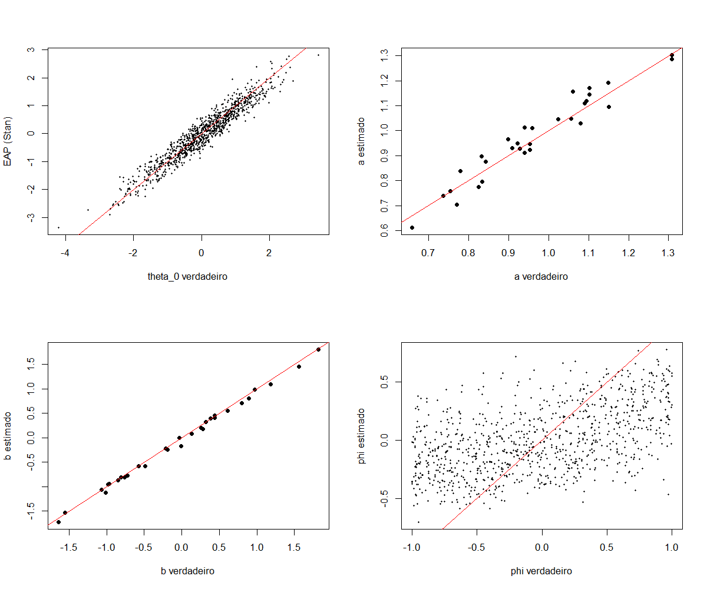

# Simulação em TRI: efeito humano-máquina

Este repositório reúne o estudo de simulação da minha Iniciação Científica em Teoria de Resposta ao Item (TRI), orientada pelo Prof. Gabriel Assunção. A ideia é verificar se, a partir das respostas a um mesmo teste aplicado em três momentos, é possível recuperar o efeito do uso de uma máquina sobre a habilidade das pessoas.

Na simulação atual (configurada em [`R/config.R`](R/config.R), com `seed = 15`), são geradas as respostas de 1.000 pessoas a 30 itens. Os parâmetros são estimados de duas formas: com o pacote mirt, ajustando o 2PL só com as respostas do tempo 0, e com um modelo bayesiano em Stan, que usa os três tempos ao mesmo tempo e estima os efeitos diretamente.

## Modelo

Cada pessoa *i* responde aos mesmos *J* itens nos tempos *t* = 0, 1, 2, segundo o modelo logístico de dois parâmetros (2PL):

```math
P(X_{ijt} = 1) = \mathrm{logit}^{-1}\big(a_j\,(\theta_{it} - b_j)\big)
```

De um tempo para o outro, a habilidade muda por um efeito comum a todos ($\delta_h$) e, para quem usa a máquina ($I_i = 1$), por um efeito que varia de pessoa para pessoa, dado por $\delta_{hm}$ e $\phi_i$:

```math
\begin{aligned}
\theta_{i1} &= \theta_{i0} + \delta_{hm}\, I_i\, \phi_i + \delta_h \\
\theta_{i2} &= \theta_{i1} + \delta_{hm}\, I_i\, \phi_i^2 + \delta_h
\end{aligned}
```

A tabela abaixo traz os valores usados para gerar os dados e as priors do modelo em Stan, que estão em [`stan/modelo_tri.stan`](stan/modelo_tri.stan). As distribuições seguem a parametrização do R e do Stan: N(média, desvio-padrão) e lognormal(meanlog, sdlog).

| Símbolo | Significado | Valor na simulação | Prior no Stan |
|---|---|---|---|
| $\theta_{i0}$ | habilidade inicial | $N(0, 1)$ | $N(0, 1)$ |
| $I_i$ | 1 se a pessoa usa a máquina | Bernoulli(0,9) | — (observado) |
| $\phi_i$ | quanto a pessoa se beneficia (ou se prejudica) com a máquina | $U(-1, 1)$ | $U(-1, 1)$ |
| $\delta_{hm}$ | efeito humano-máquina | 0,5 | half-normal(0, 1) |
| $\delta_h$ | efeito humano, comum a todos | 0,1 | $N(0, 1)$ |
| $a_j$ | discriminação do item | lognormal(0; 0,18) | lognormal(0; 0,5) |
| $b_j$ | dificuldade do item | $N(0, 1)$ | $N(0, 5)$ |

## Como reproduzir

As funções e os parâmetros da simulação ficam em `R/`, o modelo em `stan/` e a execução está dividida em três scripts numerados em `scripts/`, que gravam os resultados em `output/`. O projeto usa R 4.5 e CmdStan 2.40 (no Windows, também é preciso o [Rtools](https://cran.r-project.org/bin/windows/Rtools/) para compilar o modelo). Ao abrir `ic-tri-simulacao.Rproj` no RStudio, o [renv](https://rstudio.github.io/renv/) é ativado sozinho e usa as versões de pacotes registradas no `renv.lock`; no Windows, o `.Rprofile` guarda essa biblioteca em `%LOCALAPPDATA%\R\renv\library`, fora da pasta do projeto. Com o projeto aberto, basta rodar:

```r
renv::restore()                          # instala os pacotes do renv.lock (só na primeira vez)
# cmdstanr::install_cmdstan()            # se ainda não tiver o CmdStan

source("scripts/01_simulacao.R")         # gera os dados (output/simulacao.rds e dados_simulados.csv)
source("scripts/02_recuperacao_mirt.R")  # 2PL no tempo 0 com mirt
source("scripts/03_recuperacao_stan.R")  # Stan: 15 a 20 min (4 cadeias em paralelo)
```

O ajuste completo do Stan (`output/fit_stan.rds`, cerca de 120 MB) passa do limite do GitHub, por isso fica fora do Git e é criado de novo pelo terceiro script.

## Resultados e discussão (uma réplica, `seed = 15`)

O ajuste do Stan convergiu sem transições divergentes, com $\hat{R}$ máximo de 1,009 e tamanho efetivo de amostra (ESS) mínimo perto de 500. Os dois efeitos globais foram bem recuperados: o efeito humano-máquina ($\delta_{hm}$, valor verdadeiro 0,5) teve média a posteriori de 0,492, com intervalo de credibilidade de 90% de 0,422 a 0,561, e o efeito humano ($\delta_h$, valor verdadeiro 0,1) ficou em 0,101, de 0,081 a 0,121. Para os outros parâmetros, a tabela compara as estimativas com os valores verdadeiros (correlação, viés e RMSE) e mostra, no Stan, a cobertura dos intervalos de 90%.

| Parâmetro | Método | Correlação | Viés | RMSE | Cobertura |
|---|---|---:|---:|---:|---:|
| $\theta_0$ | mirt | 0,917 | −0,037 | 0,412 | — |
| $\theta_0$ | Stan | 0,959 | −0,038 | 0,292 | 0,901 |
| $a$ | mirt | 0,870 | 0,040 | 0,100 | — |
| $a$ | Stan | 0,966 | 0,010 | 0,045 | 0,967 |
| $b$ | mirt | 0,994 | −0,032 | 0,101 | — |
| $b$ | Stan | 0,998 | −0,041 | 0,065 | 0,933 |
| $\phi$ (só quem usa a máquina) | Stan | 0,504 | 0,032 | 0,506 | 0,882 |



A comparação de $\theta_0$, $a$ e $b$ favorece o Stan, que usa os três tempos, enquanto o mirt só tem o tempo 0. Já o efeito individual da máquina ($\phi_i$, no gráfico de baixo à direita) é mal identificado: com 30 itens, o erro de medida de $\theta$ (cerca de 0,3) é da mesma ordem que o efeito individual máximo da máquina (0,5), então as estimativas de $\phi_i$ ficam puxadas para zero. As priors ainda são provisórias e podem ser alteradas posteriormente.

## Autor

Atilio Souza Mantovani
